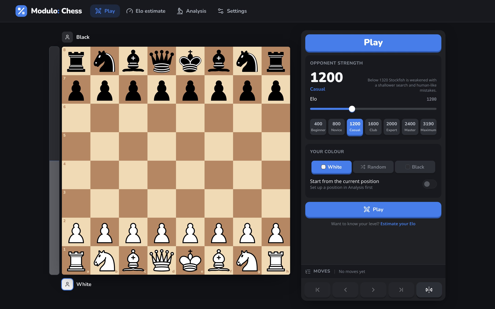
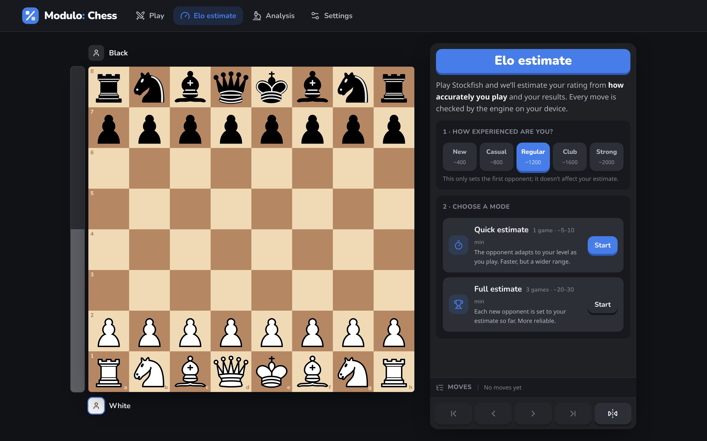
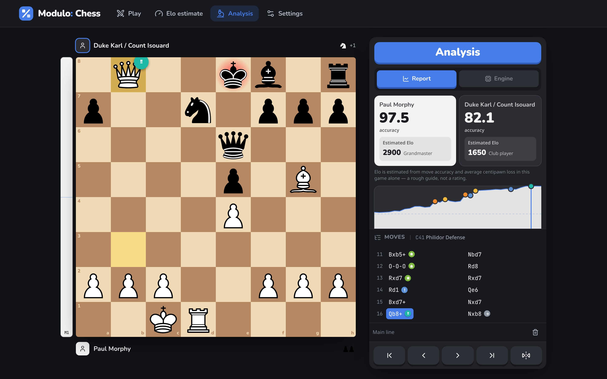
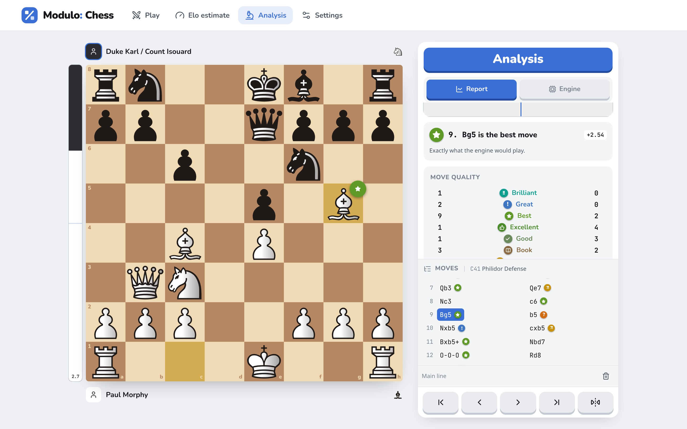
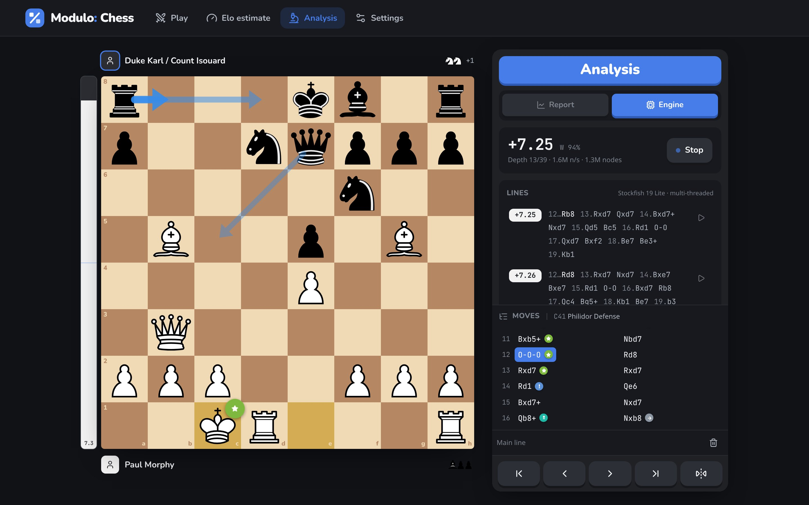
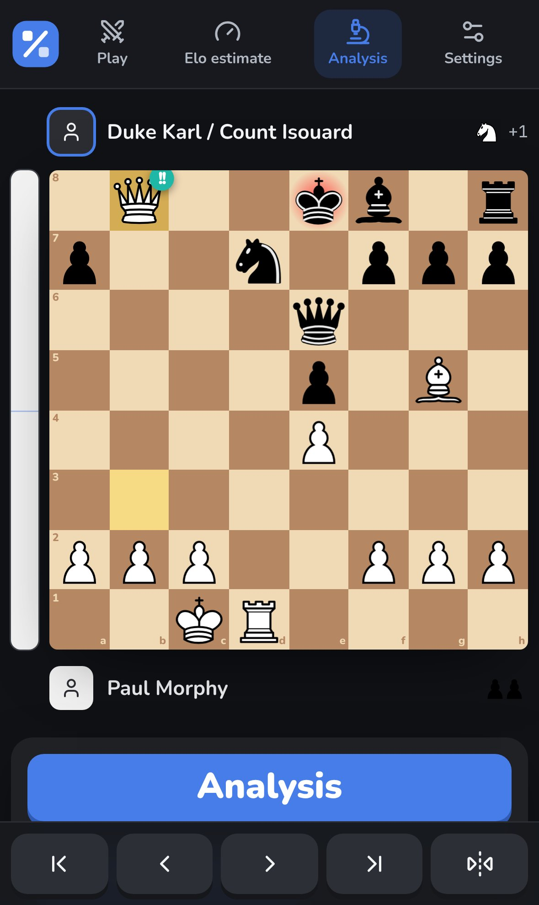
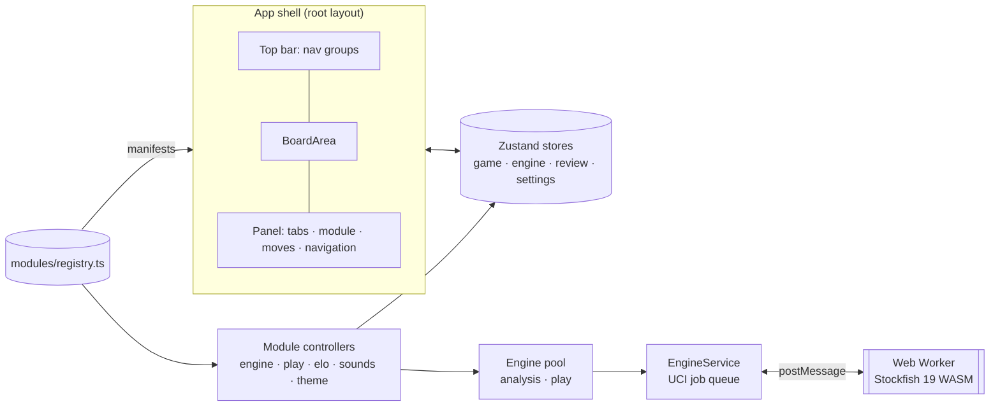

# Modulo: Chess

**A modular chess analysis and play platform. Stockfish 19 runs entirely in your browser: no account, no backend, and nothing leaves your device.**

Every feature is an isolated _module_ that plugs into a small core: the board and play, an Elo estimate, the engine, game review, import/export, openings and settings. New features can be added without refactoring anything, which is where the name comes from. The logo is a modulo operator (`%`) whose dots are chess squares.

[](https://vercel.com/new/clone?repository-url=https%3A%2F%2Fgithub.com%2Fleiffurthersocial-rgb%2Fmodulo-chess&project-name=modulo-chess&repository-name=modulo-chess)

| Play vs Stockfish (Elo 250–3190)              | Elo estimate                                   |
| --------------------------------------------- | ---------------------------------------------- |
|  |  |

| Game report: classifications, accuracy, Elo per player | Game report (light theme, Merida pieces)                 |
| ------------------------------------------------------ | -------------------------------------------------------- |
|        |  |

| Live engine analysis                              | Mobile                                                                         |
| ------------------------------------------------- | ------------------------------------------------------------------------------ |
|  |  |

---

## Features

**Board & play**

- Custom animated board: drag-and-drop (mouse and touch), click-to-move, legal-move hints, last-move and check highlights, promotion picker, flip, coordinates.
- Moves animate because piece identity is tracked between positions; a CSS transform does the rest.
- Move list with **variations** (every move from an earlier position creates a branch), comments and NAGs, plus promote/delete variation. Navigate with the arrow keys or by clicking.
- Play Stockfish at any **Elo from 250 to 3190**, with presets from Beginner (400) to Maximum. From 1320 up, Stockfish's own `UCI_LimitStrength`/`UCI_Elo` is used. Below 1320 (Stockfish's floor), Modulo weakens it itself: a shallower MultiPV search, a move _sampled_ by how much win probability it gives away, and occasional beginner-style oversights (`src/core/engine/strength.ts`).
- Play as White, Black or random, optionally from the current position. Takeback, resign, rematch, and one click to review the game.

**Elo estimate**

- **Quick estimate (1 game):** the opponent adapts while you play. After a few moves it moves halfway towards your running estimate, at most 200 points at a time.
- **Full estimate (3 games):** colours alternate, and each new opponent is set to your estimate so far. This gives a tighter range.
- Every position is evaluated in the background on the analysis engine. Your non-book moves are scored by **win-probability accuracy** (harmonic mean, as lichess does, so single blunders count) and **average centipawn loss**. Move quality is blended with a **performance rating** from your results against each opponent's Elo, and quality gets more weight the longer the game. You get an estimate with a likely range (`src/core/analysis/eloEstimate.ts`). Past estimates are kept in `localStorage`.

**Local Stockfish analysis**

- Stockfish 19 (lite NNUE) compiled to WebAssembly, running in a Web Worker.
- The **multi-threaded** build is used when the page is cross-origin isolated. It **falls back to single-threaded** automatically when `SharedArrayBuffer` is unavailable or the threaded build fails.
- Live eval bar plus numeric evaluation (centipawns / mate-in-N, from White's point of view), win %, depth / seldepth, nodes/sec and node count.
- **MultiPV 1–5** with principal variations in SAN. Hover or click a move to preview it on the board, double-click to play the line up to that move, and ▶ to play the first move. Best-move arrows are drawn for each line.
- Start/stop toggle (`E`), plus threads, hash, depth limit and MultiPV, all persisted in `localStorage`.

**Game report** (Analysis → Report, modelled on chess.com's Game Review and WintrChess)

- Paste, upload or drop a PGN and the analysis **starts immediately**. Loading from the Import page, or pressing "Review" after a game, does the same.
- Every move gets one of 11 classes: **brilliant, great, best, excellent, good, book, forced, inaccuracy, mistake, miss, blunder** (`src/core/analysis/classify.ts`, `report.ts`):
  - **Loss bands** on win-probability loss: excellent < 2%, good < 5%, inaccuracy < 10%, mistake < 20%, otherwise blunder.
  - **Brilliant:** a sound **sacrifice**, where the move newly leaves ≥ 2 pawns of material en prise beyond what it captured (`sacrifice.ts`). It must be (near-)best and leave you ≥ 40%. In an already-won position it must also be the key to the win (forces mate, or the alternatives are ≥ 10% worse).
  - **Great:** the engine's move when the second-best is ≥ 20% worse and changes the outcome. Recaptures, escapes from check and mating moves never count.
  - **Miss:** a mistake or blunder right after the opponent's error, when you're still doing fine afterwards (you failed to punish it rather than lost).
  - **Forced:** the only legal move. **Book:** moves while the game stays in the bundled ECO lines.
- **Accuracy** follows lichess' algorithm: a volatility-weighted mean averaged with a harmonic mean, so single blunders count.
- **Estimated Elo for both players**, from move accuracy and average centipawn loss in that game (`eloEstimate.ts`). In testing, Kasparov–Topalov 1999 gave ≈2875 / ≈2500–2775 depending on depth, and Morphy's Opera Game gave ≈2900 / ≈1650.
- An interactive eval graph with coloured markers, a move-quality table, key moments, and a per-move card ("Rd1 is the only good move…"). It shows the best alternative and its line, with a board preview, and can play it as a variation. A green "best was" arrow appears on the board, and every move in the list gets its icon.
- **Fast:** positions are spread across parallel single-threaded Stockfish workers (cores − 1). See _Performance_ below.

**Import / export**

- The Report tab's loader accepts PGN or FEN (auto-detected), a `.pgn` upload, or drag-and-drop. Multi-game files open a picker.
- Copy or download the PGN (variations, comments and NAGs preserved) from the report. The full import/export page (with FEN copy) is still at `/import`.

**Openings**

- The Engine tab names the current opening (ECO code + name) from 3,800+ bundled lines (CC0). The full panel at `/openings` adds book continuations, and is built on an `OpeningExplorerProvider` interface so a database-backed explorer can be added later.

**Design**

- Dark theme by default plus light and system themes, all as CSS variables. There are 5 board themes and 4 open-licensed piece sets.
- Clear two-part layout. A top bar holds the pages (Play, Elo estimate, Analysis, Settings). The board stands alone on the left, with player cards and the eval bar. **All controls** live in one panel card on the right: a title banner, chunky tabs for the page's tools, the content, the move list, and move navigation at the bottom. On mobile the panel sits below the board and move navigation is pinned to the bottom of the screen.
- Slate palette with a single blue accent, Nunito for headings and buttons, Noto Sans for text, and JetBrains Mono for moves and numbers. Buttons are "pressable" 3D controls. Motion is subtle and respects `prefers-reduced-motion`.
- Accessible: the board is an ARIA grid with a roving keyboard cursor (arrows + Enter to move pieces). Visible focus states, live regions for engine and game status, a skip link, and a `?` shortcut sheet.
- Synthesized move, capture, check and game-end sounds (WebAudio, no audio assets), which can be toggled off.

## Quick start

Requires Node.js ≥ 20.9.

```bash
npm install        # also copies the Stockfish WASM files into public/stockfish/
npm run dev        # http://localhost:3000
```

| Script                            | What it does                                                                                               |
| --------------------------------- | ---------------------------------------------------------------------------------------------------------- |
| `npm run dev` / `build` / `start` | Next.js dev server / production build / production server                                                  |
| `npm run lint`                    | ESLint (Next.js core-web-vitals + TypeScript + Prettier compat)                                            |
| `npm run format` / `format:check` | Prettier                                                                                                   |
| `npm run typecheck`               | `next typegen` + `tsc --noEmit` (strict)                                                                   |
| `npm test`                        | Vitest unit tests (UCI parsing, eval normalization, classification, PGN, EngineService races, board logic) |
| `npm run verify:engine`           | End-to-end browser check of the engine (see below)                                                         |
| `npm run build:openings`          | Rebuilds `src/modules/openings/data/openings.json` from `data/openings/*.tsv`                              |

### End-to-end engine verification

```bash
npm run build && npm start
```

```bash
npm i -D playwright && npx playwright install chromium   # once
npm run verify:engine -- http://localhost:3000
```

This drives a real Chromium through 17 checks:

- cross-origin isolation and the multi-threaded boot
- 3 MultiPV lines that deepen with nodes/sec
- correct lines after rapid position changes
- a clean stop
- loading a PGN with variations in the Report tab: auto-analysis, move classes, an Elo estimate for both players, and key moments
- drag-and-drop and keyboard-only moves
- a reply from a 400-Elo (custom-weakened) engine opponent
- a quick Elo estimate that ends in a rating
- the single-threaded fallback when COOP/COEP are stripped
- mobile overflow and page errors

## Architecture

```
src/
├── app/                      Next.js App Router: root layout (hosts the shell), [[...slug]] routes
├── core/                     Framework-free logic (unit tested)
│   ├── engine/               EngineService (UCI client), transport, parser, eval math, worker boot, pool
│   ├── chess/                Game tree with variations, PGN parser/serializer, FEN helpers
│   ├── analysis/             Move classification, accuracy, Elo estimation
│   ├── modules/              ModuleManifest type + registry
│   ├── models/               Domain models & repository interfaces for roadmap features
│   └── sound/                WebAudio sound kit
├── modules/                  ← features live here
│   ├── registry.ts           the only list of installed modules
│   ├── board/                Play panel, engine opponent controller, sounds + hotkeys
│   ├── elo-estimate/         Quick / full Elo estimate: panel, session, background evaluator
│   ├── engine/               Engine panel + live-analysis controller
│   ├── game-review/          Game report: loader, parallel review runner, eval graph
│   ├── import-export/        PGN/FEN import & export
│   ├── openings/             ECO lookup, explorer provider interface, bundled data
│   └── settings/             Settings panel + theme controller
├── stores/                   Zustand stores (game, engine, review, elo, settings, openings, toasts)
├── components/               board/, shell/ (AppShell, BoardArea, MoveList), ui/ primitives
└── themes/                   Board themes and piece-set metadata
```



### The module system

A module is a folder in `src/modules/<id>/` whose `index.ts` exports a `ModuleManifest` (see `src/core/modules/types.ts`):

```ts
export interface ModuleManifest {
  id: string; // kebab-case, unique
  name: string; // nav / tab label
  description: string; // page metadata + header
  icon: ComponentType; // lucide-react icon
  route?: string; // e.g. "/analysis"; "/" = default module
  order: number; // order within its group
  group?: string; // top-bar page it belongs to (defaults to its id)
  panel?: ComponentType; // shown in the page's panel
  controller?: ComponentType; // headless, mounted once for the app's lifetime
  shortcut?: string; // single key that opens the panel
  hidden?: boolean;
}
```

The registry (`createRegistry(manifests, navGroups)`) validates ids and routes so mistakes fail the build. Each **nav group** is one top-bar page; modules that share a group become tabs in that page's panel. For example, `game-review` (Report) and `engine` are the two tabs under **Analysis**. `openings` and `import-export` also belong to that group but are `hidden`: they stay routable (`/openings`, `/import`) without cluttering the tab bar. The shell derives everything else from the manifests: the top bar, panel tabs, keyboard shortcuts, background controllers and the statically generated routes, via `generateStaticParams` in `app/[[...slug]]/page.tsx`. The workspace lives in the root layout, so the board, engine and review state survive navigation between modules.

### Adding a module

1. Create `src/modules/puzzles/PuzzlesPanel.tsx` (a `"use client"` component). Read and write shared state through the stores: `useGame` for the board/tree, `useEngine`, `useSettings`, and so on.
2. Create `src/modules/puzzles/index.ts`:
   ```ts
   import { Puzzle } from "lucide-react";
   import type { ModuleManifest } from "@/core/modules/types";
   import { PuzzlesPanel } from "./PuzzlesPanel";

   export const puzzlesModule: ModuleManifest = {
     id: "puzzles",
     name: "Puzzles",
     description: "Tactics training.",
     icon: Puzzle,
     route: "/puzzles",
     group: "puzzles", // or "analysis" to appear as a tab on the Analysis page
     order: 60,
     panel: PuzzlesPanel,
     shortcut: "z",
   };
   ```
3. Add `puzzlesModule` to the array in `src/modules/registry.ts`. If it starts a new page, also add a `NavGroup` (label, icon, order, `showMoves`) to `NAV_GROUPS` there.

That's all. `/puzzles` is generated at build time, and the module appears in the top bar, or as a tab on its group's page. If the module needs background work, such as a clock or a websocket, give it a `controller`. If it needs the engine, call `getEngine("analysis" | "play")` from `src/core/engine/pool.ts`, or add a new role.

## How Stockfish is integrated

- **Package.** [`stockfish@19.0.1`](https://www.npmjs.com/package/stockfish) (Nathan Rugg's stockfish.js) compiles the [official Stockfish](https://github.com/official-stockfish/Stockfish) to WASM. It ships five builds. Modulo uses the two **lite** builds, about 1.7 MB each: `stockfish-19-lite.js` (multi-threaded) and `stockfish-19-lite-single.js`. The full-network builds are about 99 MB each, which is impractical to download on a website.
- **Serving.** `scripts/copy-engine.mjs` runs on `postinstall`, `predev` and `prebuild`. It copies the builds and their licence from `node_modules` to `public/stockfish/<version>/`, and checks that `src/core/engine/assets.ts` matches the installed version. The versioned path is served with `Cache-Control: immutable`. Each `.js` file loads its sibling `.wasm` and starts its own thread workers from its own URL, so the bundler never touches it.
- **Worker boot** (`core/engine/browser.ts`). If `crossOriginIsolated && SharedArrayBuffer` holds, it boots the multi-threaded build; if that throws or times out, it falls back to the single-threaded build. The UI shows the reason for any fallback. You can also force a build in Settings.
- **`EngineService`** (`core/engine/EngineService.ts`) is a typed, promise-based UCI client over an `EngineTransport`, so tests can use a fake engine:
  - `init()` handles the `uci`/`uciok` and `isready`/`readyok` handshake and collects options.
  - `setOptions()` sends only changed options, clamped to the engine's min/max, then syncs.
  - `newGame()` sends `ucinewgame` and syncs.
  - `search(request, { onUpdate, supersede })` returns a handle with a `result` promise and `cancel()`.
  - **Race-freedom invariant:** jobs run strictly one at a time, and a new `go` is never sent until the previous search's `bestmove` has arrived. Every `info` line can therefore be attributed to exactly one search. A superseding search drops queued searches and sends `stop` to the running one. Late `info` lines from cancelled searches are ignored. Unit tests fire 25 overlapping requests at an async fake engine and assert that no lines leak between searches and that `go` never overlaps.
- **Normalization.** UCI scores are relative to the side to move; they are converted to White's point of view (`mate 0` means the side to move is mated). Win % uses the lichess/Stockfish logistic curve (`k = 0.00368208`, cp clamped to ±1000).
- **Roles.** Live analysis and the Elo estimator use the `analysis` engine (user threads/hash). The play-mode opponent has its own `play` engine (1 thread, 16 MB, strength-limited). Game reports use a pool of `review-N` workers (single-threaded builds).

### Performance

Game review evaluates every main-line position at a fixed depth (default 16; Fast 12 and Deep 20 are available):

- **Parallel workers.** `cores − 1` single-threaded Stockfish workers each search different positions. Many short searches scale far better this way than one engine with several threads. All cores was only about 5% faster and made the UI stutter, so one core is left free.
- **Cheap "great" detection.** Each position gets one MultiPV-1 search. Only when the player then found the best move is there a second, reduced-depth search over the remaining moves (UCI `searchmoves`), to get the second-best score. This is cheaper than running MultiPV 2 everywhere. Note that `searchmoves` must be the last `go` argument: Stockfish reads every following token as a move, and a `depth` after it was silently ignored, giving an infinite search.
- **Reproducible.** Worker k always owns positions k, k+W, k+2W… and walks them backwards, with its hash cleared once. Later positions lie inside earlier positions' search trees, so the hash keeps helping, and the same game always gives the same report on the same machine.
- **Cached.** Evaluations are cached per position and depth, so re-running a report is instant.

Measured on a 4-core machine, Kasparov–Topalov 1999 (88 positions):

|                                     | before                                        | now                                         |
| ----------------------------------- | --------------------------------------------- | ------------------------------------------- |
| depth 14                            | 12.0 s (1 engine × 3 threads, best move only) | **8.2–9.4 s**, including second-best probes |
| depth 16                            | —                                             | **≈18 s**                                   |
| Opera Game, depth 16 (34 positions) | —                                             | ≈6–7 s                                      |

## Deployment

### Headers (COOP/COEP)

Multi-threaded WASM needs `SharedArrayBuffer`, which requires cross-origin isolation. `next.config.ts` sends these headers on every route, including static files in `public/`:

```
Cross-Origin-Opener-Policy: same-origin
Cross-Origin-Embedder-Policy: require-corp
Cross-Origin-Resource-Policy: same-origin
```

Everything the app loads is same-origin: `next/font` self-hosts the fonts and the pieces live in `/public`, so `require-corp` blocks nothing. If you add third-party embeds, scripts or images, they must send `Cross-Origin-Resource-Policy: cross-origin`; otherwise the app still works but drops to the single-threaded engine. On Vercel the `next.config.ts` headers apply to static assets too, so `vercel.json` deliberately does **not** repeat them (duplicated values would make COEP invalid). Vercel serves `.wasm` as `application/wasm` out of the box.

### GitHub

```bash
gh repo create modulo-chess --public --source=. --remote=origin --push
```

The repository already lives at `leiffurthersocial-rgb/modulo-chess`. GitHub Actions (`.github/workflows/ci.yml`) runs install, lint, format check, typecheck, tests and build on every pull request and on pushes to `main`.

### Vercel

**Option A: dashboard.** Click **Deploy with Vercel** above, or go to [vercel.com/new](https://vercel.com/new) and import the GitHub repo. The framework (Next.js), install (`npm ci`) and build (`npm run build`) commands come from `vercel.json`. No environment variables are needed. Every push to `main` deploys to production and every PR gets a preview URL.

**Option B: CLI.**

```bash
npm i -g vercel
```

```bash
vercel link          # create or link the project
```

```bash
vercel git connect   # deploy automatically on push
```

```bash
vercel --prod        # first production deploy
```

After deploying, open the site and run `crossOriginIsolated` in the console; it should print `true`. The Analysis → Engine tab (`/engine`) should show `· multi-threaded`.

## Licensing

- **Modulo: Chess source code: MIT** (see `LICENSE`).
- **Stockfish: GPL-3.0.** The engine is not vendored in this repo. It is installed from npm (`stockfish`, GPL-3.0) and served unmodified as separate files at `/stockfish/<version>/`, together with its licence (`COPYING.txt`). The app talks to it only through the UCI text protocol over `postMessage`, the same arms-length arrangement GUIs like lichess and chess.com use. What this means for you:
  - If you deploy Modulo, you are distributing Stockfish binaries. You must make the corresponding source available; linking to [official-stockfish/Stockfish](https://github.com/official-stockfish/Stockfish) and [nmrugg/stockfish.js](https://github.com/nmrugg/stockfish.js) at the matching version does that, and the Settings → About panel already links both. You must also keep the licence file served.
  - If you **modify or rebuild** the engine, you must publish your modified engine source under GPL-3.0.
  - Bundling Stockfish **into** the app's own JavaScript, rather than running it as a separate worker program, could make the combined work subject to GPL-3.0. Keep it separate if you want the rest of the code MIT.
  - _This is a practical summary, not legal advice._
- **Piece sets:** Cburnett and Merida (GPLv2+), Chessnut (Apache-2.0), Spatial (MIT). All are redistributed unmodified from lichess-org/lila with credits in `public/pieces/CREDITS.md` and in the app's About section.
- **Opening data:** [lichess-org/chess-openings](https://github.com/lichess-org/chess-openings), CC0.
- **Fonts:** Geist and Geist Mono (SIL OFL), Instrument Serif (SIL OFL), self-hosted via `next/font`.

## Roadmap

The design is ready for these; none of them are built yet. Domain models and repository interfaces live in `src/core/models` (`SavedGame`, `GameRepository`, `PositionAnalysis`, `AnalysisRepository`, `TrainingItem`, `SharedAnalysis`, `UserProfile`).

- **Accounts & saved games:** an `accounts` module plus a `GameRepository` implementation (IndexedDB first, then an API). PGN is the canonical storage format.
- **Shareable analysis links:** encode `SharedAnalysis` (PGN + ply + orientation) in the URL and hydrate `useGame` on load.
- **Online play:** a `play-online` module with a websocket `controller`; the board already supports per-colour movability.
- **Puzzles & opening trainer:** modules driven by `TrainingItem`. The openings module's provider interface feeds the trainer.
- **Game database & real opening explorer:** new `OpeningExplorerProvider`s (masters, Lichess, personal games) with move statistics.
- **Cloud analysis:** an `AnalysisRepository` backed by a server engine, keyed by EPD so local and cloud results merge.

## Known limitations

- Games live in memory; a full page reload starts a fresh board. Settings persist. Saved games are on the roadmap.
- The lite NNUE is weaker than full Stockfish (still far beyond human strength). Depth/nps are lower in single-threaded mode, for example on hosts without COOP/COEP or in browsers that refuse `SharedArrayBuffer`.
- From 1320 up, play uses Stockfish's own `UCI_Elo` calibration (engine-vs-engine, long time controls), which can feel stronger than human ratings at the low end. Levels below 1320 come from Modulo's own weakening model, which is tuned by hand rather than calibrated against rated humans.
- Elo estimates are heuristic. The accuracy and centipawn-loss curves are approximations of typical online ratings, and short or one-sided games carry little information. That's why a range is shown, and why the full 3-game mode is more reliable.
- Reports run the lite NNUE at depth 16 in the browser, where chess.com uses a full-strength engine on servers. In very sharp positions the evaluation, and therefore some classes, can differ from chess.com. The thresholds for brilliant, great and miss are my own reading of chess.com's published definitions (their exact rules are not public).
- The per-game Elo estimate is heuristic and works best on games of 20+ moves. It reflects how accurately someone played in _this_ game, which depends on how sharp the game was.
- Under Partial Prerendering, unknown URLs show the in-app "Off the board" message but return HTTP 200.
